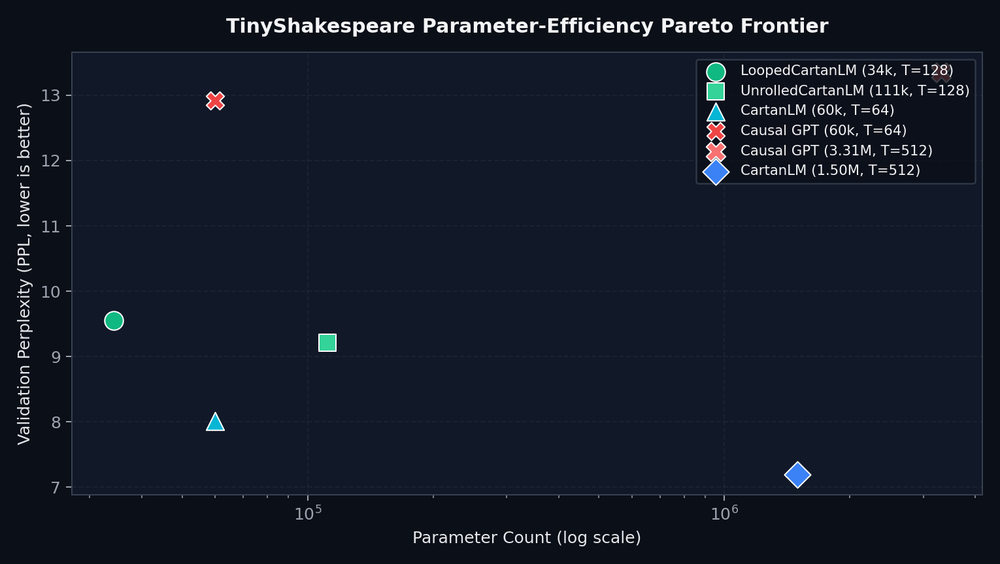
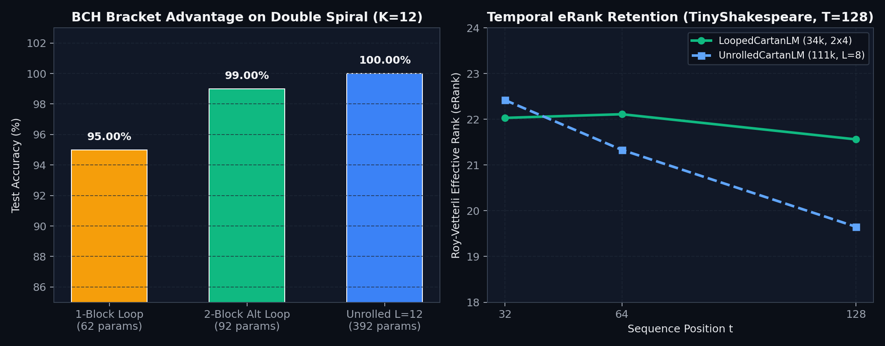
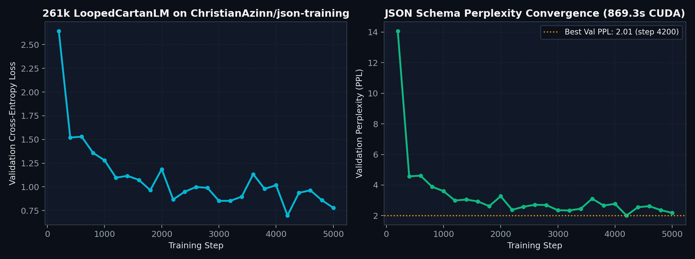

# LoopedCartan (`LoopedCartanLM`)

Weight-tied **2-Block Alternating Port-Hamiltonian Language Model** ($\Phi_A \circ \Phi_B)^{K/2}$, combining symplectic Relativistic-Pendulum kicks, $\mathcal{O}(T)$ FLA real-split chunked log-cumsum causal mixing, position-gated canonical momentum Rayleigh damping, and multi-head $\mathrm{U}(N)$ Cayley channel rotors.

## Why 2-Block Alternating Loops?
- **Non-Commuting BCH Expressivity:** Looping `1` identical block integrates a time-independent flow, whereas alternating `2` blocks $(\Phi_A \circ \Phi_B)^{K/2}$ generates non-commuting Baker-Campbell-Hausdorff brackets $[H_A, H_B] \neq 0$.
- **3.26x–4.26x Parameter Compression:** Achieves unrolled-depth expressivity with `34k`–`261k` parameters.
- **Rank Preservation:** Preserves Roy-Vetterli effective rank (`eRank`) across long sequences without transformer rank collapse.

## Verified Results & Visuals

### 1. Parameter-Efficiency Pareto Frontier (`TinyShakespeare`)


| Model | Params | Context $T$ | Val PPL $\downarrow$ |
| :--- | ---: | ---: | ---: |
| `LoopedCartanLM` (2 blocks, $K=8$) | `34,244` | `128` | `9.55` |
| `UnrolledCartanLM` (8 blocks) | `111,632` | `128` | `9.21` |
| `Causal GPT` (60k) | `60,004` | `64` | `12.92` |
| `Causal GPT` (3.31M) | `3,307,264` | `512` | `13.35` |
| `CartanLM` (1.50M, A100) | `1,495,056` | `512` | **`7.19`** |

### 2. BCH Loop Ablation & Temporal eRank Retention


### 3. End-to-End JSON Training (`ChristianAzinn/json-training`, `261,376` params)


## Quickstart
```bash
pip install torch datasets matplotlib
python generate_charts.py
python train_json.py
```
